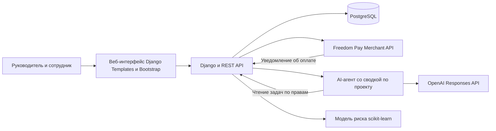

# Черновая архитектура

- Django проверяет роль и доступ к проекту при чтении и изменении задач. История и сроки хранятся в PostgreSQL.
- Внешние API — платёжный сервис и LLM. Тариф активируется после проверки уведомления провайдера. Тестовый режим согласуем с преподавателем.
- Агент вызывает функцию чтения доступных задач и формирует сводку со ссылками. Функция не меняет данные. LLM получает только поля, нужные для ответа.
- Модель обучается отдельно. В Milestone 3 Django загружает артефакт модели и рассчитывает риск из данных, известных на момент прогноза. Фактическая дата закрытия используется только для разметки.
- Docker Compose запускает веб-приложение и БД. Android остаётся в плане диплома и позднее сможет использовать тот же API.

## Почему этот стек

| Компонент | Выбор и обоснование |
|---|---|
| Frontend | Django Templates и Bootstrap. Сценарий можно собрать из форм и таблиц без отдельного SPA. |
| Backend | Django и Django REST Framework. На одном сервере будут вход, правила ролей и API для интеграций. |
| База данных | PostgreSQL. Внешние ключи связывают заказчиков, проекты и задачи, а транзакции помогают сохранить согласованность статуса и истории. |
| Платежи | Freedom Pay Merchant API. Оплата проходит на странице провайдера, а результат приходит на сервер. Доступ к тестовому режиму уточняем заранее. |
| AI | OpenAI Responses API с вызовом функции. Агент запрашивает задачи через сервер, который проверяет права доступа. |
| ML | pandas для подготовки данных и scikit-learn для логистической регрессии. Простую модель можно сопоставить с базовым правилом. |

[Freedom Pay](https://docs.freedompay.kz/overview-660954m0) · [Вызов функций OpenAI](https://developers.openai.com/api/docs/guides/function-calling) · [Логистическая регрессия](https://scikit-learn.org/stable/modules/generated/sklearn.linear_model.LogisticRegression.html)
